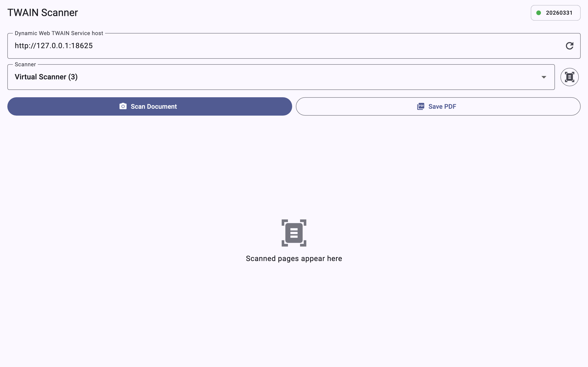
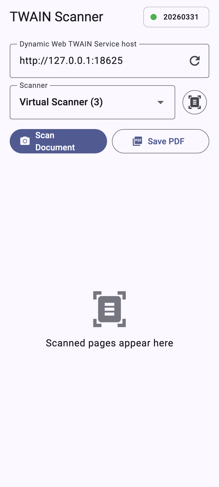

# Flutter Document Scanner for TWAIN, WIA, SANE, ICA and eSCL Scanners

| Desktop (macOS) | Mobile (Android) |
|-----------------|------------------|
|  |  |

A pure Dart client for the [Dynamic Web TWAIN Service REST API](https://www.dynamsoft.com/web-twain/restfulapi/). The Dynamsoft service runs on the machine that is connected to the scanners, and your app talks to it over HTTP — no native code, so the same package works on **Android, iOS, web, Windows, macOS and Linux**.

## ⚙️ Prerequisites

1. Install the [Dynamic Web TWAIN Service](https://www.dynamsoft.com/web-twain/restfulapi/) on the scanner host: [Windows](https://demo.dynamsoft.com/DWT/DWTResources/dist/DynamsoftServiceSetup.msi) · [macOS](https://demo.dynamsoft.com/DWT/DWTResources/dist/DynamsoftServiceSetup.pkg) · [Linux (.deb)](https://demo.dynamsoft.com/DWT/DWTResources/dist/DynamsoftServiceSetup.deb) / [.rpm](https://demo.dynamsoft.com/DWT/DWTResources/dist/DynamsoftServiceSetup.rpm)
2. Request a [free 30-day trial license](https://www.dynamsoft.com/customer/license/trialLicense/?product=dcv&package=cross-platform).
3. The service listens on `http://127.0.0.1:18625`. Open that URL in a browser to bind it to a LAN IP if you need access from other devices.

## 🚀 Getting Started

```bash
flutter pub add flutter_twain_scanner
```

Scan a document and download it as a PDF:

```dart
import 'package:flutter_twain_scanner/flutter_twain_scanner.dart';

final service = DynamsoftService();
const host = 'http://127.0.0.1:18625';

// List scanners, scan into a document and download it as a PDF.
final scanners = await service.getDevices(host);
final document = await service.createDocument(host, {});
final job = await service.createJob(host, {
  'license': 'YOUR-LICENSE-KEY',
  'device': scanners.first['device'],
  'config': {'IfShowUI': false, 'Resolution': 200},
});

// Copy every scanned page into the document.
while (true) {
  final pages = await service.getImageInfo(host, job['jobuid']);
  if (pages.isEmpty) break;
  await service.insertPage(host, document['uid'], {
    'password': '',
    'source': pages.first['url'],
  });
}
await service.deleteJob(host, job['jobuid']);

final pdfBytes = await service.getDocumentStream(host, document['uid']);
```

The [example](example/) app shows a complete scanning UI:

```bash
cd example
flutter run -d macos   # or windows, linux, android, ios
```

## 📚 API Reference

All methods throw a `DynamsoftServiceException` when the service returns an error. The scan job parameters follow the service's [`CreateScanJobOptions` schema](https://www.dynamsoft.com/web-twain/docs/info/api/restful.html).

### Scanning

| Method | Description |
|--------|-------------|
| `getServerInfo(host)` | Service version and compatibility |
| `getDevices(host, [scannerType])` | List scanners, optionally filtered by `ScannerType` flags |
| `createJob(host, parameters)` | Create a scan job (`license`, `device`, `config`, …) |
| `checkJob(host, jobId)` / `updateJob(...)` / `deleteJob(...)` | Check, start/cancel or delete a job |
| `getScannerCapabilities(...)` / `getScannerSettings(...)` | Capabilities and TWAIN settings of the scanner running a job |
| `getImageInfo(host, jobId)` | Metadata and source URL of the next scanned page (empty when done) |
| `getNextPage(host, jobId)` / `getImageStreams(host, jobId)` | Scanned pages as PNG byte streams |
| `getImageFiles(host, jobId, directory)` | Save all pages as PNG files. Not supported on the web |
| `getPageStream(host, jobId, {page, type})` | A single page by index as PNG or JPEG |

### Documents

| Method | Description |
|--------|-------------|
| `createDocument(host, parameters)` | Create a document, optionally password-encrypted |
| `getDocumentInfo(...)` / `updateDocument(...)` / `deleteDocument(...)` | Read, re-label or delete a stored document |
| `getDocumentStream(host, docId)` | Download a document as a PDF byte stream |
| `getDocumentFile(host, docId, directory)` | Download a document as a PDF file. Not supported on the web |
| `insertPage(host, docId, parameters)` | Insert a scanned page into a document at an optional position |
| `deletePage(host, docId, page)` | Delete a page by UID or index |

## 📄 License

This project is licensed under the [MIT License](LICENSE).
